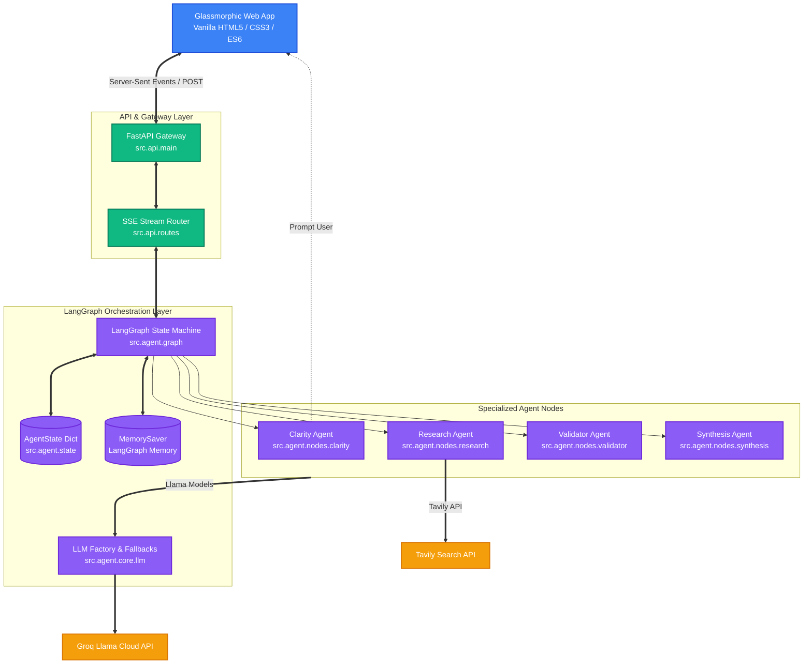
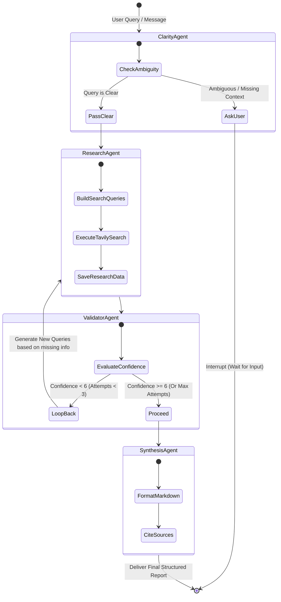

# 🌌 Nexus AI — Multi-Agent Research Assistant

<div align="center">


[](https://fastapi.tiangolo.com)
[](https://github.com/langchain-ai/langgraph)
[](https://groq.com)
[](https://pytest.org)
[](https://www.docker.com)

**A production-grade, highly collaborative multi-agent research suite built on LangGraph, FastAPI, and a futuristic glassmorphic user interface.**

[Features](#-key-features) • [System Architecture](#-system-architecture) • [Agent Pipeline](#-the-multi-agent-orchestration-engine) • [Tech Stack](#-technical-foundation) • [Installation](#-setup--installation) • [Running](#-running-the-platform) • [Verification](#-verification-testing)

</div>

---

## 📖 Overview

**Nexus AI** is a state-of-the-art multi-agent platform designed to conduct deep, context-aware business research. Powered by **LangGraph's state machine architecture**, it breaks down complex user queries, automates recursive web search, evaluates information quality against dynamic confidence thresholds, and synthesizes polished executive reports in real-time. 

Unlike standard "black-box" wrappers, Nexus AI supports **Human-in-the-Loop clarification** and streams intermediate agent reasoning live to the user via **Server-Sent Events (SSE)**.

---

## ✨ Key Features

- **🧠 Stateful Multi-Agent Collaboration:** Managed by a strict LangGraph state machine with full memory persistence.
- **🔄 Smart Validator Loop:** Automatic quality checking with recursive feedback loops back to search agents if confidence thresholds aren't met.
- **⚡ Real-Time Streaming UI:** Glassmorphism UI showing intermediate agent states, active agent cards, and token-by-token Markdown responses.
- **🗣️ Human-in-the-Loop (HITL):** Clarity Agent automatically detects ambiguous terms and prompts the user for clarification before executing heavy queries.
- **🛡️ Token-Throttling Guardrails:** Sliding-window context memory & automatic text-truncation mechanisms to prevent LLM rate-limit (413/429) errors.
- **🐳 Enterprise Packaging:** Structured logging, custom Exception Handlers, Pytest unit tests, and fully optimized multi-stage Docker builds.

---

## 🏗️ System Architecture

Nexus AI strictly adheres to a **modular, layered architecture** ensuring high cohesion, low coupling, and clear boundaries between Presentation, Application, and Domain layers.



### Directory Structure

```text
nexus-ai-research-assistant/
├── src/
│   ├── core/                      # Core configuration and bootstrapping
│   │   └── config.py              # Centralized settings (API keys, thresholds, model settings)
│   ├── agent/                     # LangGraph Multi-Agent implementation
│   │   ├── state.py               # TypedDict state structure
│   │   ├── graph.py               # Node connections and conditional routes
│   │   ├── core/                  # Core Utilities & Managers
│   │   │   ├── llm.py             # LLM factory & exponential backoff handler
│   │   │   ├── memory.py          # Sliding-window conversation memory
│   │   │   └── tools.py           # Tavily search tool & text truncation
│   │   └── nodes/                 # Single Responsibility Principle Node Handlers
│   │       ├── clarity.py         # Human-in-the-Loop Clarification Node
│   │       ├── research.py        # Search query builder & crawler
│   │       ├── validator.py       # Confidence checker & loop detector
│   │       └── synthesis.py       # Synthesis & markdown formatter
│   ├── api/                       # FastAPI Server Architecture
│   │   ├── main.py                # FastApi entrypoint, logging, static file serving
│   │   ├── routes.py              # SSE and Chat REST endpoints
│   │   └── schemas.py             # Pydantic models for strict type validation
│   └── web/                       # Presentation Layer
│       ├── index.html             # Futuristic glassmorphic structural layout
│       ├── styles.css             # Cyberpunk/glassmorphism dark UI styling
│       └── app.js                 # EventSource stream consumer and UI animator
├── tests/                         # Pytest Automation Suite
├── Dockerfile                     # Optimized multi-stage Docker build
├── requirements.txt               # Pin-point Python dependencies
└── README.md                      # Comprehensive developer handbook
```

---

## 🤖 The Multi-Agent Orchestration Engine

Nexus AI orchestrates four highly specialized agents, each focused on a single responsibility:

| Agent | Icon | Core Function | Decision Logic |
| :--- | :---: | :--- | :--- |
| **Clarity Agent** | `🗣️` | Analyzes conversation memory and new inputs to detect ambiguous queries or lack of context. | If ambiguous → Route to `__interrupt__` (ask user).<br>If clear → Route to **Research Agent**. |
| **Research Agent** | `🔍` | Dynamically generates optimized search keywords and retrieves live data using Tavily API. | Executes search, truncates results, updates state. Route to **Validator Agent**. |
| **Validator Agent** | `🛡️` | Conducts semantic validation, ensuring search results fully address the user query. | If confidence < 6 and attempts < 3 → Loop back to **Research Agent** with feedback.<br>Otherwise → Route to **Synthesis Agent**. |
| **Synthesis Agent** | `✍️` | Aggregates all validated information and formats it into a publication-grade markdown report. | Formats research data, details sources, and terminates the graph cleanly. |

### Stateful Workflow Pipeline



---

## 💻 Technical Foundation

Nexus AI is engineered using high-performance, industry-standard modern frameworks:

- **Agent Framework:** [LangGraph](https://github.com/langchain-ai/langgraph) (highly controlled cyclic state graphs) + [LangChain Community](https://github.com/langchain-ai/langchain)
- **FastAPI Core:** Extremely fast, asynchronous [FastAPI](https://fastapi.tiangolo.com/) engine with [Uvicorn](https://www.uvicorn.org/) ASGI.
- **Inference Engines:** [Groq Cloud API](https://groq.com/) using `llama-3.1-8b-instant` for ultra-low-latency utility nodes and `llama-3.3-70b-versatile` for detailed analytical synthesis.
- **Search Infrastructure:** [Tavily Search API](https://tavily.com/) configured with enhanced parsing rules.
- **Client Presentation:** Modern Dark/Glassmorphic responsive layout with real-time SSE progress tracker, dynamic pipeline node updates, and smooth CSS animations.

---

## 🛠️ Setup & Installation

### Prerequisites
- Python `3.9` or higher
- Groq Cloud API Key
- Tavily Search API Key

### 1. Clone & Enter Directory
```bash
git clone https://github.com/r-muhammadahmadabbas/nexus-ai-research-assistant.git
cd nexus-ai-research-assistant
```

### 2. Configure Environment Variables
Create a `.env` file in the root directory:
```env
# API Keys (Required)
GROQ_API_KEY=gsk_your_groq_api_key_here
TAVILY_API_KEY=tvly_your_tavily_api_key_here

# App Configurations (Optional defaults)
APP_HOST=0.0.0.0
APP_PORT=8000
```

### 3. Installation Options

#### Option A: Local Installation (Virtual Environment)
```bash
# Create virtual environment
python -m venv venv

# Activate Virtual Env (Windows PowerShell)
.\venv\Scripts\activate

# Activate Virtual Env (Linux/macOS)
source venv/bin/activate

# Install dependencies
pip install -r requirements.txt
```

#### Option B: Docker Installation (Containerized)
```bash
# Build the production Docker image
docker build -t nexus-ai-research-assistant .

# Run the container
docker run -p 8000:8000 --env-file .env nexus-ai-research-assistant
```

---

## 🚀 Running the Platform

If you chose **Option A** (Local Installation), run the FastAPI server using the following:

```bash
uvicorn src.api.main:app --host 0.0.0.0 --port 8000 --reload
```

Once running, access the services:
* 🌐 **Interactive Web UI:** [http://localhost:8000](http://localhost:8000)
* 📖 **Swagger OpenAPI Docs:** [http://localhost:8000/docs](http://localhost:8000/docs)
* 📊 **ReDoc Documentation:** [http://localhost:8000/redoc](http://localhost:8000/redoc)

---

## 📊 Quality Assurance & Stress Testing

The platform features an enterprise-grade automated testing suite using `pytest`. It achieves comprehensive coverage across state machines, API routes, LLM fallback nodes, and sliding context window logic.

### Running Automated Tests
```bash
pytest -v
```

### Tested Failure Scenarios

| Test Case | Objective | Outcome |
| :--- | :--- | :--- |
| **Multi-Turn Context** | Check pronoun resolution (e.g., "Apple" followed by "Who is their CEO?") | ✅ Pass (MemorySaver retains thread graph state) |
| **State Sanitization** | Ensure switching topics resets prior stale search queries | ✅ Pass (State cleared correctly in Clarity Node) |
| **Token Truncation** | Force massive context returns through Tavily to test Groq rate limits | ✅ Pass (Automatic 2,000-char search result truncation) |
| **Edge-Case / Gibberish** | Input random characters or empty queries | ✅ Pass (Gracefully handled by Clarity Agent) |
| **Validator Loop** | Query obscure or fake topics to trigger insufficient data loops | ✅ Pass (Validator loops, then terminates on max attempts) |

---

## 📈 Roadmap & Development Milestones

- [x] **Milestone 1:** Initialize modular project structure and strict configurations.
- [x] **Milestone 2:** Develop Clarity, Research, Validator, and Synthesis LangGraph nodes.
- [x] **Milestone 3:** Create FastAPI endpoints, logging layers, and static middleware.
- [x] **Milestone 4:** Design and develop the Glassmorphic Real-Time UI.
- [x] **Milestone 5:** Connect Server-Sent Events (SSE) for token-by-token and agent-activation streaming.
- [x] **Milestone 6:** Harden against API limit bottlenecks using dynamic sliding window memory and text truncation.
- [x] **Milestone 7:** Package with multi-stage Docker builds and comprehensive Pytest automation scripts.
- [ ] **Milestone 8:** Implement vector database indexing (Pinecone/Chroma) for persistent context caching.
- [ ] **Milestone 9:** Add support for local models via Ollama.

---

## 📄 License & Terms

This project is licensed under the **MIT License**. Feel free to use, modify, and distribute it in accordance with the license conditions.

Developed with 💜 by [Muhammad Ahmad Abbas](https://github.com/r-muhammadahmadabbas).
